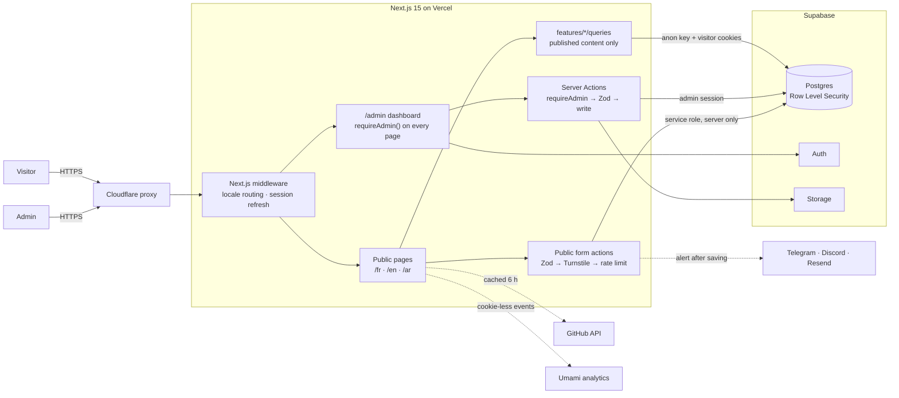

# Keltoum Malouki — Portfolio & CMS

A trilingual portfolio (French, English, Arabic right-to-left) with its own content management system. Every project, article, skill and price on the public site is edited from a private admin dashboard and stored in Supabase. Database security rules decide who can read and write what.

**Live site: [keltoummalouki.com](https://www.keltoummalouki.com)**

[](https://github.com/Keltoummalouki/MyPortfolio/actions/workflows/ci.yml)


<table>
  <tr>
    <td width="72%"></td>
    <td></td>
  </tr>
  <tr>
    <td colspan="2"></td>
  </tr>
</table>

## What it does

**Public site** (`/fr`, `/en`, `/ar`)
- A short home page: hero, profile summary, experience, three featured projects, reviews and a contact form.
- Case studies for each project (`/projects/[slug]`), written in Markdown.
- A full profile page (`/about`): education, skills, certifications and live GitHub activity.
- A blog, with an RSS feed per language (`/en/blog/rss.xml`).
- A freelance page: how I work, packages with starting prices, an optional booking link and a project request form.
- Public forms for contact messages, project requests and moderated reviews.

**Admin dashboard** (`/admin`, sign-in required)
- Edit projects, articles, experience, education, skills, certifications, FAQ, packages and prices, social links and theme, in all three languages.
- Read the contact inbox and manage freelance leads through a status pipeline.
- Get a Telegram, Discord or email alert as soon as a message or project request arrives, with a link to it in the dashboard. Submissions flagged as spam send nothing.
- Approve reviews before they are published.

## Architecture



The UI never writes database queries itself. Each domain lives in `src/features/<domain>/` with the same layout:

| File | Role |
| --- | --- |
| `schema.ts` | Zod validation; safe to import in the browser |
| `map.ts` | Pure functions from database rows to UI data, unit-tested without a database |
| `queries.ts` | Server-only reads under the visitor's security context |
| `actions.ts` | Server Actions: check admin, validate, write, revalidate |

## Main technical decisions

- **The database is the security boundary.** Every table has Row Level Security. Admin rights come from a SQL function (`public.is_admin()`) over an `admin_profiles` table, never from user metadata the client could change. Pages and Server Actions check too, but a bug there still can't expose drafts or other people's data.
- **The service-role key is used in exactly two places:** inserting public submissions and the rate limiter. Everything else runs with the visitor's or admin's own permissions.
- **Public forms are layered:** Zod validation, a Cloudflare Turnstile check, then a per-IP rate limit. IPs are stored only as HMAC hashes, and errors returned to the browser are deliberately vague (`invalid`, `captcha`, `rate_limited`, `server`). Once a submission is saved, the owner alert goes out through `after()`, so the visitor never waits on Telegram, Discord or Resend.
- **Translations come in two forms.** Long content (projects, articles, experience) uses `*_translations` tables. Short labels (skills, FAQ, prices) use `{fr, en, ar}` JSON columns. Both fall back to French, then to any available language. Arabic is fully right-to-left, using logical CSS properties throughout.
- **The site still works when Supabase is down.** Public queries catch their own errors and fall back to defaults built from the translation files, so a database outage degrades the page instead of breaking it.
- **Schema changes are migrations.** All 20 migrations are in `supabase/migrations`. `supabase db reset` rebuilds the database from version control alone, and the TypeScript types are generated from the schema.
- **A strict Content Security Policy.** Every external origin is listed in `next.config.ts`, and the analytics origins are added only when analytics is configured. Production pages cannot run `eval`, and an end-to-end test fails on any CSP violation.
- **Privacy-friendly analytics.** Umami runs without cookies, honors Do Not Track and reports only from the production domain. Clicks are marked with `data-track` attributes, which keeps Next.js client-side navigation intact.
- **Built for search engines and AI assistants.** JSON-LD (Person, FAQPage, OfferCatalog, BlogPosting), hreflang, a sitemap, `llms.txt` and RSS. Profile facts are server-rendered and never hidden behind animations.

## Tech stack

| Area | Tools |
| --- | --- |
| Framework | Next.js 15 (App Router, Server Actions), React 19, TypeScript (strict) |
| Data | Supabase: Postgres, Row Level Security, Auth, Storage |
| UI | Tailwind CSS 4, shadcn/ui (Radix), GSAP, Framer Motion, Three.js |
| i18n | next-intl (fr default, en, ar right-to-left) |
| Validation & security | Zod, Cloudflare Turnstile, HMAC-hashed rate limiting, CSP |
| Content | Markdown rendered with `rehype-sanitize` |
| Testing | Vitest (unit tests for schemas, mappers, SEO and analytics helpers) |
| Hosting | Vercel (Paris region) behind Cloudflare |

## Running it locally

Requirements: Node.js 20+, and Docker for a local Supabase.

```bash
git clone https://github.com/Keltoummalouki/MyPortfolio.git
cd MyPortfolio
npm install
cp .env.example .env.local      # fill in the values; each one is documented in the file

npx supabase start              # local Supabase (API :54321, Studio :54323)
npx supabase db reset           # apply every migration and the seed data
npm run dev                     # http://localhost:3000
```

Turnstile, analytics and new-submission alerts are optional in development: leave their variables empty and the site works without them.

| Command | Purpose |
| --- | --- |
| `npm run dev` | Development server (Turbopack) |
| `npm run build` | Production build, also the type check |
| `npm run lint` | ESLint |
| `npm test` | Unit tests (no database needed) |
| `npm run test:e2e` | Playwright tests: contact form, language switch, Arabic RTL, CSP violations, `security.txt` (no database needed) |
| `npm run db:types` | Regenerate `src/lib/supabase/database.types.ts` after a migration |

## Project structure

```text
src/
  app/
    [locale]/           public pages: home, about, projects, blog, freelance
    admin/              sign-in and the protected dashboard
    llms.txt/  sitemap.ts  robots.ts
  features/             one folder per domain: articles, cms, content, freelance, inbox, ...
  components/           sections, admin UI, shared UI
  lib/                  Supabase clients, analytics, validation, motion helpers
messages/               fr.json, en.json, ar.json (UI labels)
supabase/               migrations and seed data
design-system/          design tokens and page rules
```

## Contact

- Website: [keltoummalouki.com](https://www.keltoummalouki.com)
- LinkedIn: [linkedin.com/in/keltoummalouki](https://www.linkedin.com/in/keltoummalouki)
- Email: [keltoummalouki@gmail.com](mailto:keltoummalouki@gmail.com)
- Security issues: please report them privately by email rather than in a public issue (see [security.txt](https://www.keltoummalouki.com/.well-known/security.txt)).
